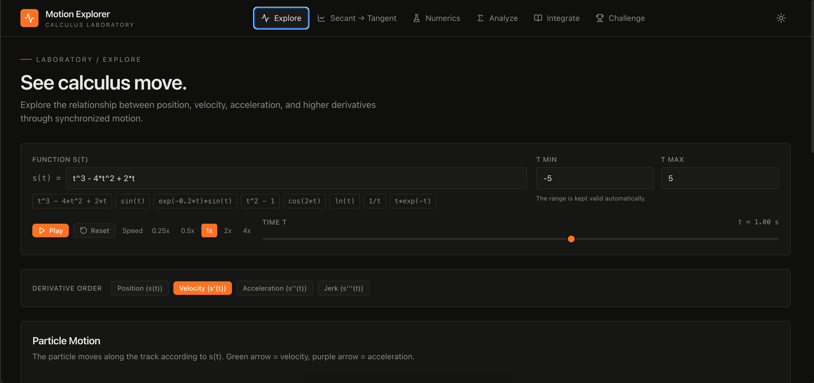
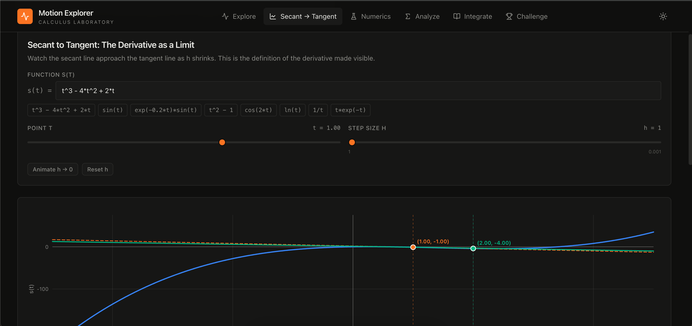
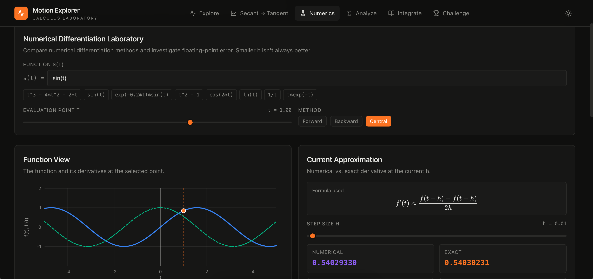
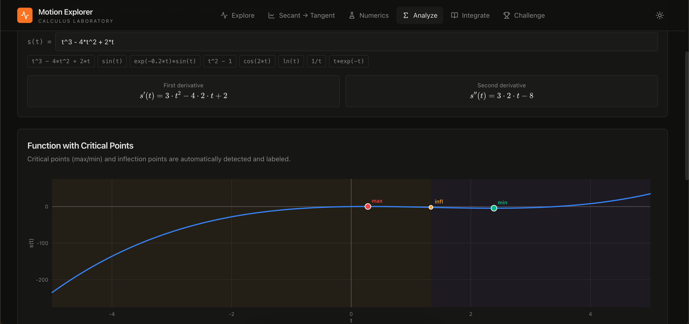
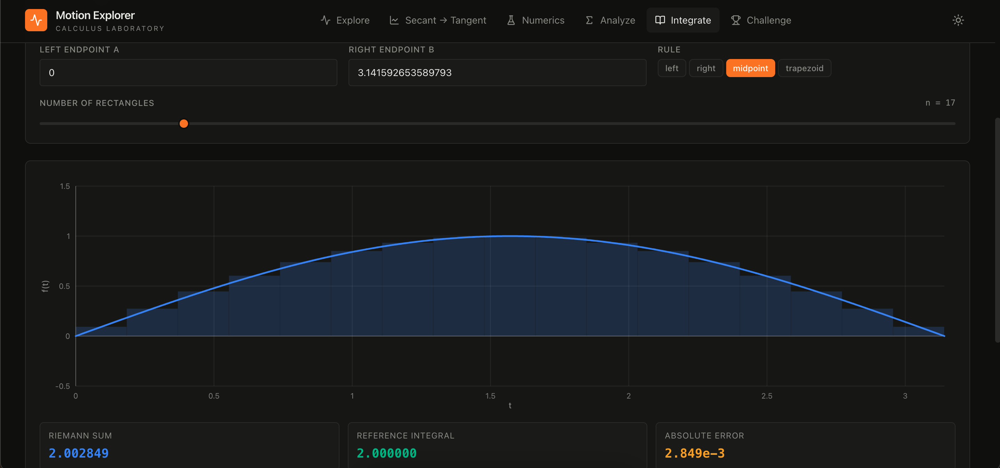
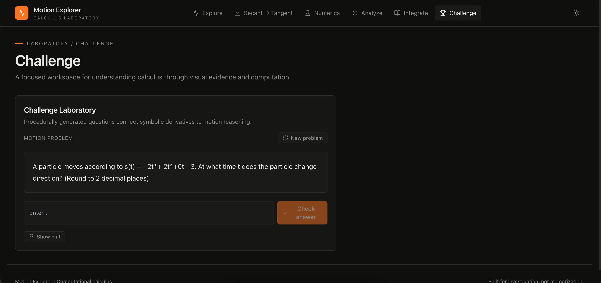
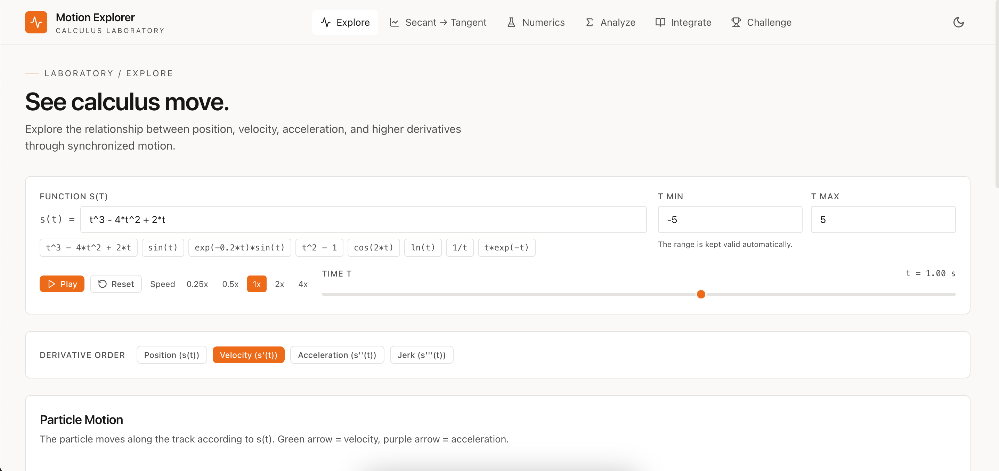
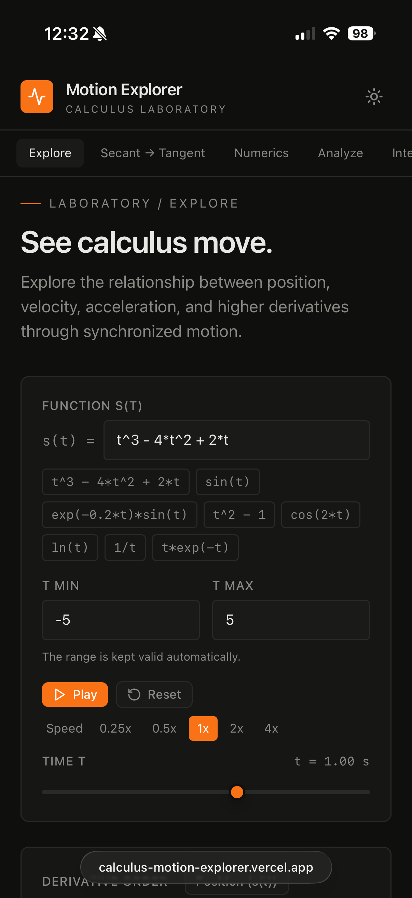

# Motion Explorer

**An interactive calculus laboratory for experimenting with derivatives, motion, numerical methods, analysis, and integration.**

[**Open the live demo**](https://calculus-motion-explorer.vercel.app/) · [Source code](https://github.com/SrinidhiKotteswaran/calculus-motion-explorer)

I started Motion Explorer because I wanted to see what calculus was *doing*, not only calculate an answer on paper. It grew from a Python prototype into a React/TypeScript application where changing a function or a numerical parameter lets you investigate how the result responds.

## Explore the labs

| Lab | What you can investigate |
|---|---|
| **Explore** | Position, velocity, acceleration, jerk, and animated particle motion |
| **Secant → Tangent** | Difference quotients, convergence toward a tangent, and symbolic derivatives |
| **Numerics** | Forward, backward, and central differences; approximation error as the step size changes |
| **Analyze** | Roots, critical points, increasing/decreasing intervals, concavity, and inflection points |
| **Integrate** | Riemann sums and numerical integration |
| **Challenge** | Procedurally generated calculus and motion problems |

## Screenshots

### Explore
See a function and its derivatives together in an interactive motion visualization.



### Secant → Tangent
Investigate how a secant slope approaches the tangent slope as the interval shrinks.



### Numerical differentiation
Compare finite-difference methods and examine approximation error.



### Calculus analysis and integration



### Generated challenges


The interface also includes light and dark themes and mobile layouts.

<table>
  <tr>
    <td align="center"><strong>Light theme</strong></td>
    <td align="center"><strong>Mobile Explore</strong></td>
  </tr>
  <tr>
    <td></td>
    <td></td>
  </tr>
</table>

## The technical core: a custom math engine

The engine in `src/lib/mathEngine.ts` turns supported mathematical expressions into an **abstract syntax tree (AST)** using a tokenizer and recursive-descent parser. It evaluates expressions numerically and transforms the tree to calculate symbolic derivatives and simplify the resulting expressions.

Implemented rules include:

- Sum and difference
- Product and quotient
- Constant-power and general-power forms
- Chain-rule forms for supported functions
- Trigonometric and inverse-trigonometric functions
- Hyperbolic, exponential, logarithmic, and square-root derivatives
- Expression simplification after differentiation

The original prototype relied on SymPy for symbolic operations. Rebuilding the expression-processing workflow in TypeScript let me work directly with parsing, tree traversal, differentiation rules, and simplification.

**Technical notes:** [Math engine architecture](docs/MATH-ENGINE.md) · [Known limitations](docs/LIMITATIONS.md)

## Numerical experiments

The Numerics lab compares forward, backward, and central finite differences. By plotting error against step size, it exposes a useful numerical-analysis trade-off: reducing the step initially improves the approximation, but eventually floating-point cancellation can dominate.

A repeatable benchmark is available with:

```bash
npm run benchmark:math
```

See [benchmark notes](docs/BENCHMARKS.md).

## How the project evolved

Motion Explorer began as a Python/Streamlit prototype using SymPy, NumPy, and Plotly. That version focused on position/velocity graphs, derivatives, and tangent lines. I then rebuilt it as a React/TypeScript/Vite application and expanded it into a set of interactive calculus labs, including a custom expression parser and symbolic differentiation engine.

- [Original Python prototype](https://github.com/SrinidhiKotteswaran/calculus-motion-visualizer)
- [Build journal](docs/BUILD-JOURNAL.md)

## Project structure

- `src/lib/mathEngine.ts` — tokenization, parsing, AST evaluation, symbolic differentiation, and simplification
- `src/lib/numerics.ts` — numerical differentiation and error calculations
- `src/lib/analysis.ts` — roots, critical points, intervals, and concavity
- `src/components/Graph.tsx` — graphing
- `src/components/ExploreMode.tsx` — motion visualization
- `src/components/SecantTangentMode.tsx` — secant/tangent experiment
- `src/components/NumericsMode.tsx` — numerical methods lab
- `src/components/AnalyzeMode.tsx` — calculus analysis
- `src/components/IntegrateMode.tsx` — numerical integration
- `src/components/ChallengeMode.tsx` — generated problems

## Run locally

Requires Node.js and npm.

```bash
git clone https://github.com/SrinidhiKotteswaran/calculus-motion-explorer.git
cd calculus-motion-explorer
npm install
npm run dev
```

Open the local URL printed by Vite.

## Verification

The repository includes a focused math-engine check and a benchmark script:

```bash
npm run test:math
npm run benchmark:math
npm run typecheck
npm run lint
npm run build
```

These commands are available for local verification; their presence in this README is not a claim that every command was run for every commit.

## Known limitations

Motion Explorer is an educational computational tool, not a general-purpose computer algebra system or arbitrary-precision numerical package. Its expression language covers a defined set of forms; symbolic transformations do not prove algebraic equivalence in all cases; numerical root finding and sampled graphs can miss narrow or pathological behavior; and real-valued domain restrictions still matter.

I keep these limitations visible because understanding where an algorithm can fail is part of understanding the algorithm. See [Technical limitations and failure analysis](docs/LIMITATIONS.md).

## Built with

React · TypeScript · Vite · Tailwind CSS · KaTeX

The original prototype used Python · Streamlit · SymPy · NumPy · Plotly
